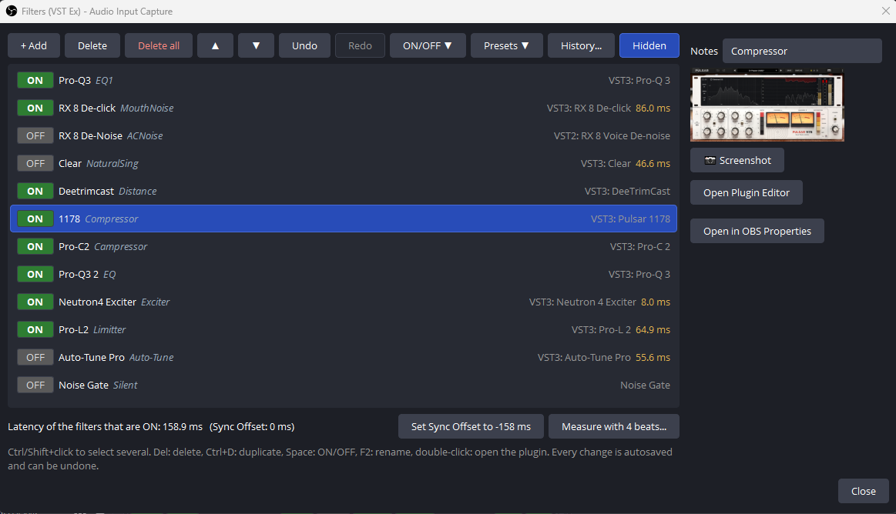
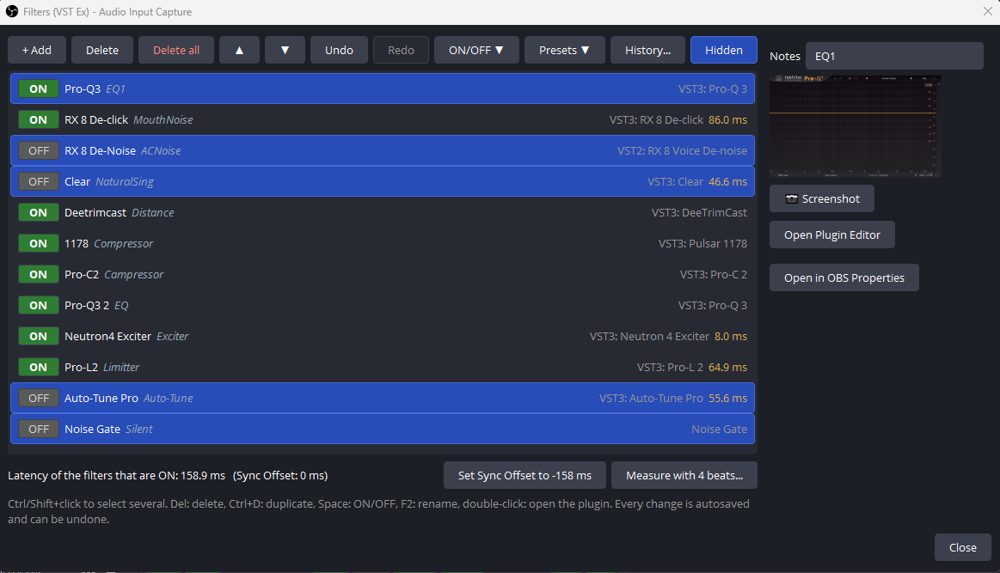
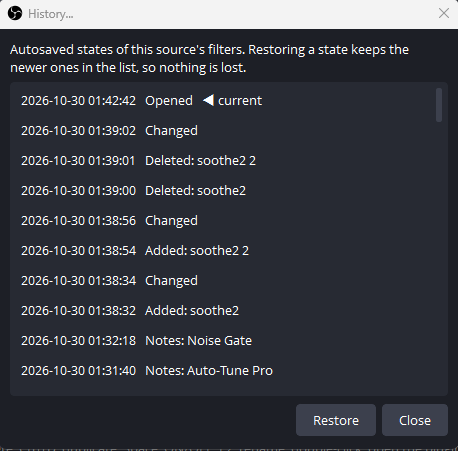
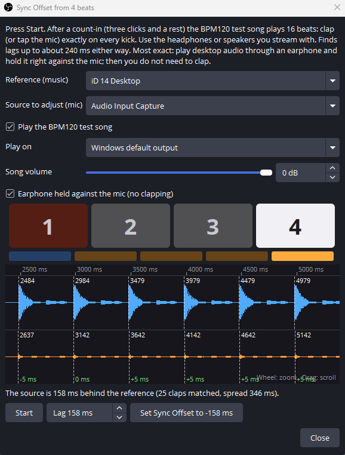
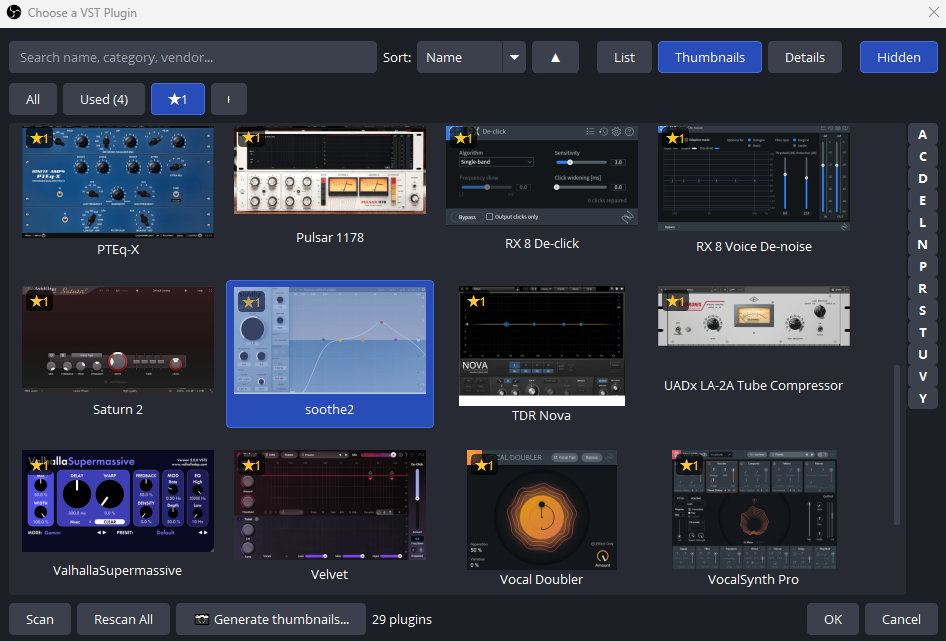
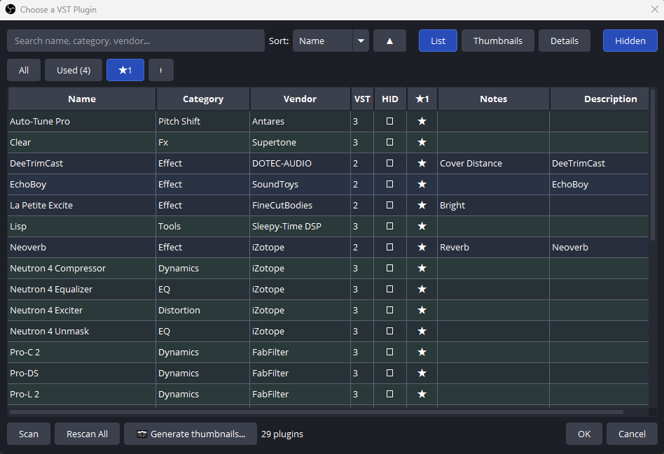
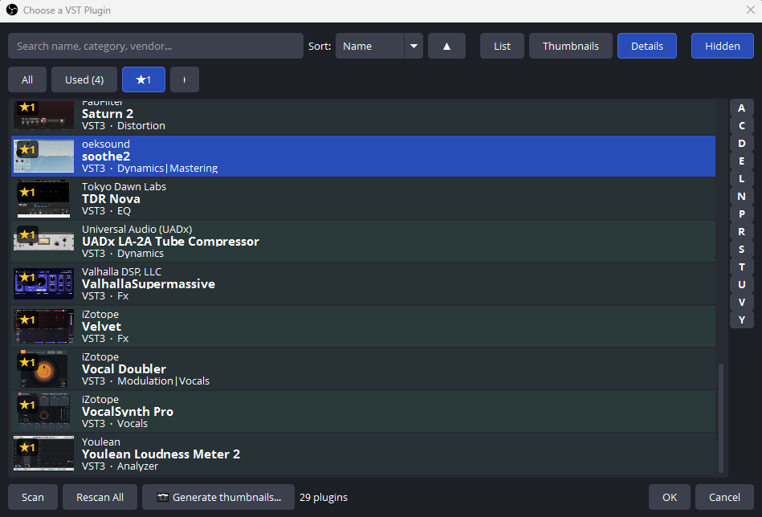
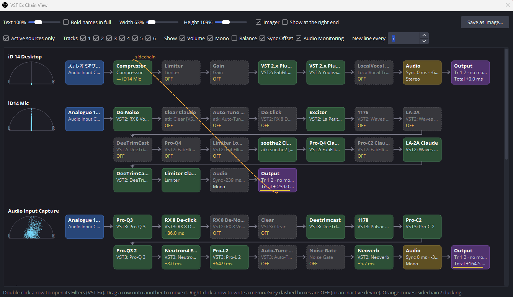
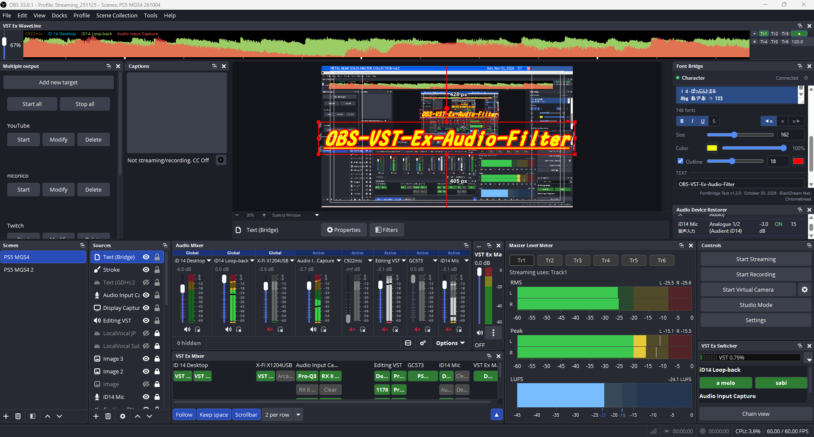

[English](README.md) | [日本語](README.ja.md) | [한국어](README.ko.md) | [Bahasa Indonesia](README.id.md) | **Français** | [繁體中文](README.zh-TW.md)

# OBS VST Ex Audio Filter

Une fenêtre de filtres audio étendue pour OBS Studio : ON/OFF instantané pour le chant en direct, outils de latence
et vue de chaîne, plus **VST Enigmax Loader**, son propre hôte **VST2 / VST3**. La fenêtre *Filtres (VST Ex)* agit
sur la même chaîne de filtres que la fenêtre *Filtres* d'OBS : on peut utiliser l'une ou l'autre.

Deux plugins OBS sont installés : **VST Ex** (fenêtre, docks et filtres intégrés) et **VST Enigmax Loader** (l'hôte
VST). Les filtres VST appartiennent à VST Enigmax Loader : s'il est retiré, OBS ne peut plus les charger. Déplacez d'abord
les filtres VST2 vers le filtre VST 2.x d'OBS avec *Transfert* (voir plus bas).

- Windows x64, OBS Studio 31 ou plus récent (testé sur 33.0)
- Auteur : BlackDream feat. ChromeBread · Licence : GPL-2.0

## Installation

1. Téléchargez `obs-vst-ex-audio-filter-<version>-windows-x64-setup.exe` depuis [Releases](../../releases).
2. Quittez OBS et lancez-le. *Installation complète* installe tout ; *Installation personnalisée* permet de choisir :
   - VST Ex Audio Filter (requis) : *Filtres (VST Ex)*, filtres hauteur / pseudo-stéréo, Outils > VST Ex Audio Filter
   - VST Enigmax Loader : plugins VST2 / VST3
   - VST Ex Chain View, dock VST Ex Mixer, dock VST Ex Switcher

   Les parties facultatives de VST Ex s'activent ou se désactivent ensuite dans Outils > VST Ex Audio Filter (après redémarrage d'OBS).
3. Lancez OBS. Au premier démarrage, il demande où garder miniatures, captures et historique.

**Portable (sans installeur)** : `obs-vst-ex-audio-filter-<version>-windows-x64-portable.zip`. Quittez OBS et
extrayez-le dans `C:\ProgramData\obs-studio\plugins\` : vous obtenez les dossiers `obs-vst-ex-audio-filter` (VST Ex)
et `vst-enigmax-loader` (VST Enigmax Loader). Omettez celui dont vous ne voulez pas. Pour retirer, quittez OBS et
supprimez les dossiers (transférez d'abord les filtres VST, voir plus bas).

**Désinstallation** (Paramètres Windows > Applications > OBS VST Ex Audio Filter). Le désinstalleur :
1. avertit si vos collections de scènes utilisent encore des filtres VST Enigmax Loader, pour les transférer d'abord ;
2. demande séparément s'il faut supprimer les miniatures, les captures haute résolution et les réglages /
   préréglages / historique, avec l'option de tout exporter avant ;
3. liste les fichiers de ses dossiers qu'il n'a pas créés (autres fichiers, copies renommées `.bak` / `.org`) et vous
   laisse supprimer ou garder chacun.

## VST Ex Audio Filter

**Fenêtre Filtres (VST Ex)** — Mixeur audio : clic droit sur une source > *Filtres (VST Ex)*
- Grands boutons ON/OFF, sélection multiple, glisser pour réordonner, dupliquer (Ctrl+D), tout supprimer, une note par filtre
- Annuler / Rétablir et un historique enregistré automatiquement qui survit aux redémarrages d’OBS
- Latence par filtre, latence totale, et un bouton qui règle le décalage de synchro pour compenser
- **Préréglages** : enregistrer / appliquer / exporter / importer toute une chaîne de filtres
- **Ensembles ON/OFF** avec décalage de synchro et volume : passer couplet → refrain en plein morceau, par raccourci
- **Mesurer sur 4 temps** : un morceau test BPM120 joue, vous tapez dans les mains (ou collez une oreillette au micro) et le décalage est calculé ; formes d’onde zoomables avec règle en millisecondes pour l’ajuster à la main

 

*Fenêtre Filtres (VST Ex) / Fenêtre Filtres (VST Ex), plusieurs filtres sélectionnés*

 

*Historique / Sync Offset sur 4 temps*

**Filtres intégrés**
- *VST Ex Transposition / Pan* : hauteur en demi-tons et panoramique, pratique pour distinguer les appareils
- *VST Ex Pseudo-stéréo* : élargit un micro mono sans DAW (effet Haas), un seul filtre à ajouter ou retirer

- Outils > VST Ex Audio Filter : langue (EN / JP / KR / ID / FR / TW), version, parties facultatives, infos de débogage, export / import de tous les réglages (mode débogage)

## VST Enigmax Loader

- VST2 et VST3, analyse sûre dans un processus séparé (lancée par vous, avec estimation du temps)
- Navigateur en liste / miniatures / détails, tri, recherche, favoris, marques HID (masquer), notes, récemment utilisés
- Miniatures prises automatiquement à la première ouverture d’un éditeur, ou toutes d’un coup ; captures par filtre
- Exporter / importer les réglages d’un plugin depuis la fenêtre de l’éditeur
- **Transfert** (Outils > VST Enigmax Loader > Mode débogage) : déplace les filtres VST2 sur place, avec leurs réglages, vers et depuis le filtre *VST 2.x Plug-in* d'OBS.
- Miniatures et captures haute résolution sont rangées dans des dossiers séparés
- Les copies d'un plugin dans des dossiers différents sont des entrées séparées, comme dans OBS : favoris, HID, notes et miniatures se règlent une par une

*Choisir un plugin VST (vue miniatures)*

 

*Choisir un plugin VST (vue liste) / Choisir un plugin VST (vue détails)*

## VST Ex Chain View

- *VST Ex Chain View* (menu Outils) : chaque source de l’appareil à la sortie, latence, niveaux, sidechain, imageur en demi-cercle (optionnel), enregistrement en image
- Choisissez ce que montrent la vue et l'image enregistrée : sources actives seulement, pistes 1 à 6, et volume, mono, balance, décalage de synchro et écoute audio un par un
- Glissez les lignes pour réordonner les sources, clic droit pour écrire un mémo à côté du nom, retour à la ligne tous les N VST

*VST Ex Chain View*

## VST Ex Mixer

- Dock *VST Ex Mixer* : une colonne par source sous les vumètres du mixeur, un bouton par VST

*OBS avec les docks VST Ex Mixer et VST Ex Switcher*

## VST Ex Switcher

- Dock *VST Ex Switcher* : boutons des ensembles ON/OFF et utilisation CPU (OBS total et part VST)

*OBS avec les docks VST Ex Mixer et VST Ex Switcher*

## Compilation

Visual Studio 2022 et CMake 3.28+ : `cmake --preset windows-x64` puis
`cmake --build build_x64 --config RelWithDebInfo`.

VST est une marque déposée de Steinberg Media Technologies GmbH.
