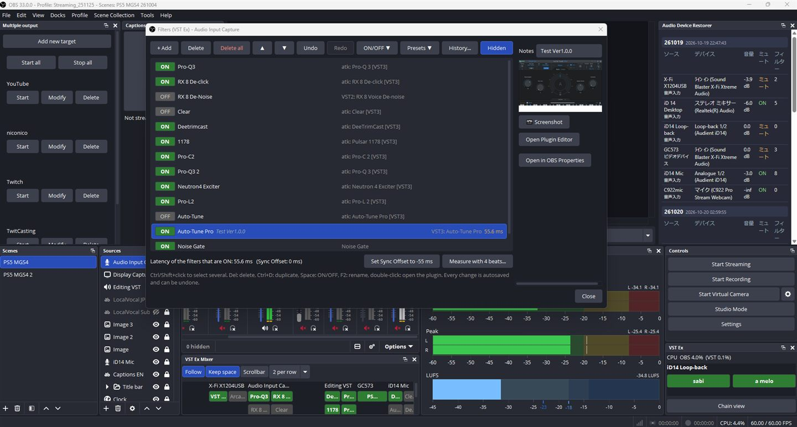
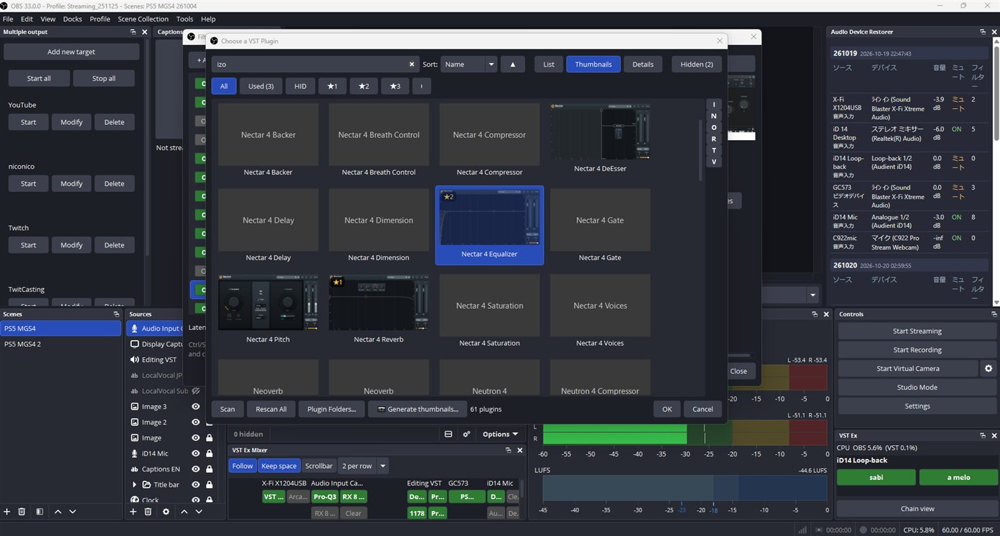

**English** | [日本語](README.ja.md) | [한국어](README.ko.md) | [Bahasa Indonesia](README.id.md) | [Français](README.fr.md) | [繁體中文](README.zh-TW.md)

# OBS VST Ex Audio Filter

An extended audio filter window for OBS Studio with instant ON/OFF switching for live singing, latency tools
and a chain view, plus **VST Enigmax Loader**, its own **VST2 / VST3** host. The *Filters (VST Ex)* window works
on the same filter chain as OBS's own *Filters* window, so you can use either.

Two OBS plugins are installed: **VST Ex** (the window, docks and built-in filters) and **VST Enigmax Loader**
(the VST host). VST filters belong to VST Enigmax Loader: when it is removed, OBS can no longer load them. Move them
to OBS's own VST 2.x filter or to atkAudio first with *Hand over* (see below).

- Windows x64, OBS Studio 31 or newer (tested on 33.0)
- Author: BlackDream feat. ChromeBread · License: GPL-2.0

## Install

1. Download `obs-vst-ex-audio-filter-<version>-windows-x64-setup.exe` from [Releases](../../releases).
2. Quit OBS and run it. *Full installation* installs everything; *Custom installation* lets you choose:
   - VST Ex Audio Filter (required): *Filters (VST Ex)*, pitch / pseudo-stereo filters, Tools > VST Ex Audio Filter
   - VST Enigmax Loader: VST2 / VST3 plugins
   - VST Ex Chain View, VST Ex Mixer dock, VST Ex Switcher dock

   The optional VST Ex parts can be switched on or off later in Tools > VST Ex Audio Filter (applies after an OBS restart).
3. Start OBS. On first start it asks where to keep thumbnails, screenshots and history.

**Portable (no installer)**: `obs-vst-ex-audio-filter-<version>-windows-x64-portable.zip`. Quit OBS and extract it
into `C:\ProgramData\obs-studio\plugins\`: you get the folders `obs-vst-ex-audio-filter` (VST Ex) and
`vst-enigmax-loader` (VST Enigmax Loader). Leave out a folder you do not want. To remove it, quit OBS and delete the
folders (hand VST filters over first, see below).

**Uninstall** (Windows Settings > Apps > OBS VST Ex Audio Filter). The uninstaller:
1. warns if your scene collections still use VST Enigmax Loader filters, so you can hand them over first;
2. asks separately whether to delete plugin thumbnails, high-resolution screenshots, and settings / presets /
   history, optionally exporting everything first;
3. lists files in its folders that it did not make (other files, renamed copies such as `.bak` / `.org`) and lets
   you delete or keep each one.

## Features

**Filters (VST Ex) window** — Audio Mixer: right-click a source > *Filters (VST Ex)*
- Big ON/OFF buttons, multi-select, drag to reorder, duplicate (Ctrl+D), delete all, a note per filter
- Undo / Redo and an autosaved history that survives OBS restarts
- Per-filter latency, total latency, and a button that sets Sync Offset to compensate
- **Presets**: save / apply / export / import a whole filter chain
- **ON/OFF sets** with Sync Offset and volume: switch verse → chorus mid-song instantly, by hotkey
- **Measure with 4 beats**: a BPM120 test song plays, you clap along (or hold an earphone to the mic) and the
  Sync Offset is computed; zoomable waveforms with a millisecond ruler for fine manual adjustment

**VST Enigmax Loader** (VST2 / VST3)
- VST2 and VST3, crash-safe scanning in a separate process (started by you, with time estimate)
- Browser with list / thumbnails / details view, sort, search, favorites, HID (hide) marks, notes, recently used
- Thumbnails taken automatically the first time an editor opens, or all at once; per-filter screenshots
- Export / import plugin settings from the editor window
- **Hand over** (Tools > VST Enigmax Loader > Debug mode): moves VST filters in place, with their settings, to and from OBS's own
  *VST 2.x Plug-in* filter (VST2) and *atkAudio PluginHost* (VST3).
- Thumbnails and high-resolution screenshots are kept in separate folders

**Built-in filters**
- *VST Ex Pitch / Pan*: pitch in semitones and pan, handy to tell devices apart when aligning them
- *VST Ex Pseudo Stereo*: widens a mono mic without a DAW (Haas effect), one filter to add or remove

**Docks and tools**
- *VST Ex Switcher* dock: ON/OFF set buttons and CPU usage (OBS total and VST share)
- *VST Ex Mixer* dock: one column per source under the Audio Mixer's meters, a button per VST
- *VST Ex Chain View* (Tools menu): every source from device to output, latency, levels, sidechain links,
  optional half-circle imager, save as image
- Tools > VST Ex Audio Filter: language (EN / JP / KR / ID / FR / TW), version, optional parts, debug information,
  export / import of all settings (debug mode)

## Preview

*Filters (VST Ex) window, VST Ex Mixer and VST Ex Switcher docks*

*Choose a VST Plugin (thumbnail view)*

## Build

Visual Studio 2022 and CMake 3.28+: `cmake --preset windows-x64` then
`cmake --build build_x64 --config RelWithDebInfo`.

VST is a registered trademark of Steinberg Media Technologies GmbH.
